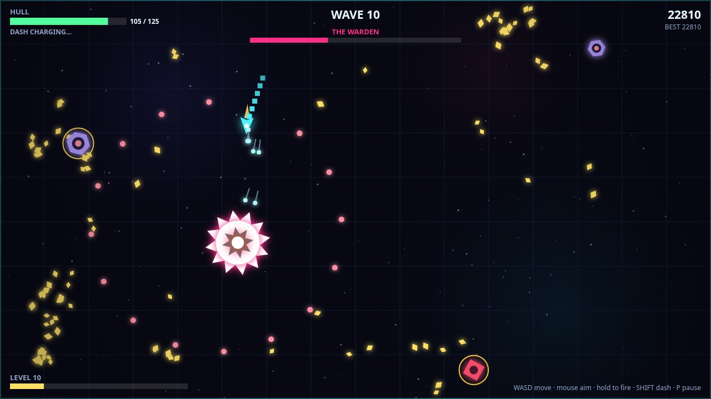

# Neon Void

A twin-stick arena survival shooter that runs entirely in the browser —
no build step, no dependencies, no assets. Everything (graphics, sound,
music) is generated in code.


## Play

Serve the folder statically and open it, e.g.:

```
npx serve .
```

Then open the printed URL in a desktop browser.

- **WASD** — move
- **Mouse** — aim, hold to fire
- **Shift / Space** — dash (with i-frames)
- **P** — pause, **M** — mute

## Features

- 10 escalating waves, 5 enemy kinds plus gold-ringed elites
- **The Warden** — a boss fight on waves 5 and 10 with telegraphed
  rings of fire, aimed fans, summons and a phase-3 spiral
- XP shards and a 3-card upgrade choice every level (8 stackable
  upgrades), combo-multiplier scoring
- Synthesized WebAudio SFX and an A-minor music loop — zero audio files
- Juice: hit-stop, screen shake, shockwave rings, bullet trails,
  low-HP vignette
- Best score persists locally; endless mode after the wave-10 win




## Structure

Plain ES modules under `src/` (config, random, audio, input, upgrades,
world, render, shots, main) — about 2,800 lines, no framework.

MIT licensed.
