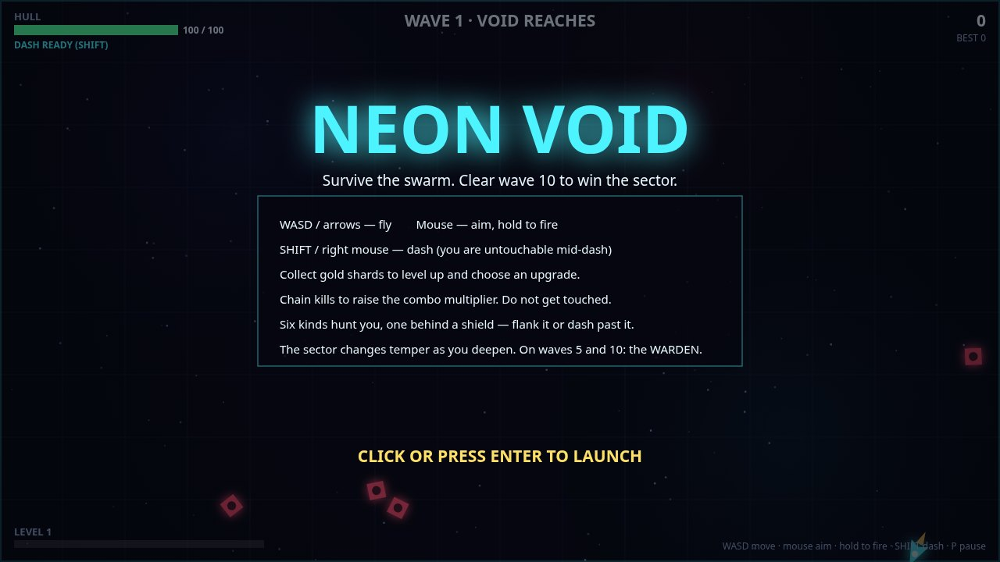
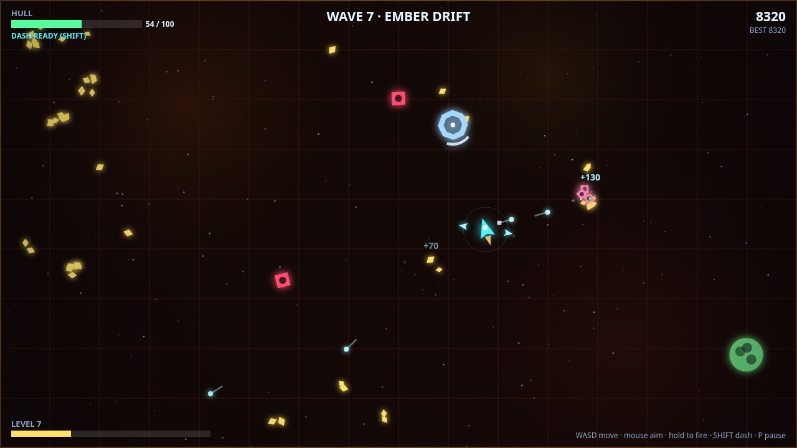

# Neon Void

A twin-stick arena survival shooter that runs entirely in the browser —
no build step, no dependencies, no assets. Everything (graphics, sound,
music) is generated in code.



## Play

Serve the folder statically and open it, e.g.:

```
npx serve .
```

Then open the printed URL in a desktop browser.

- **WASD** — move
- **Mouse** — aim, hold to fire
- **Shift / Space** — dash (with i-frames)
- **P** — pause, **M** — mute

## Features

- 10 escalating waves, 6 enemy kinds plus gold-ringed elites
- **The Bulwark** — an armoured slab hiding behind a frontal energy
  shield that tracks you at a limited rate: strafe, flank or dash
  through its arc to hurt it
- **The Warden** — a boss fight on waves 5 and 10 with telegraphed
  rings of fire, aimed fans, summons and a phase-3 spiral
- XP shards and a 3-card upgrade choice every level (9 stackable
  upgrades, including Orbital Drones that orbit you and auto-fire),
  combo-multiplier scoring
- Six sector biomes recolour the arena as the run deepens
- Synthesized WebAudio SFX and an A-minor music loop that gains a
  bass/arp intensity layer while the boss lives — zero audio files
- Juice: hit-stop, screen shake, shockwave rings, bullet trails,
  low-HP vignette
- Best score persists locally; endless mode after the wave-10 win




## Structure

Plain ES modules under `src/` (config, random, audio, input, upgrades,
world, render, shots, main) — about 2,800 lines, no framework.

MIT licensed.
